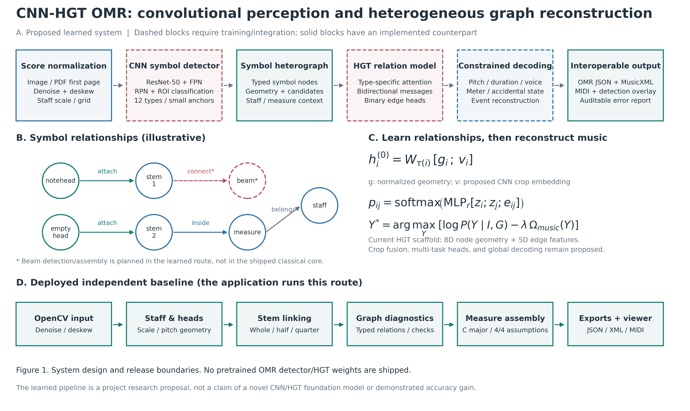
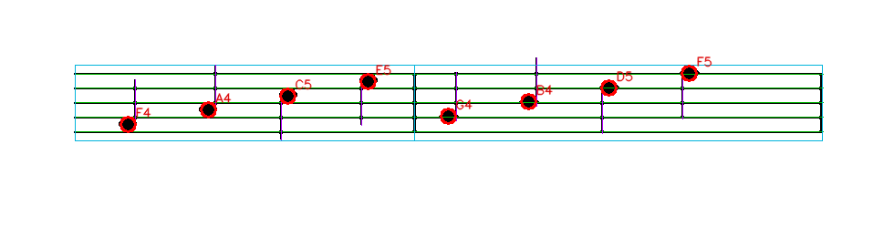
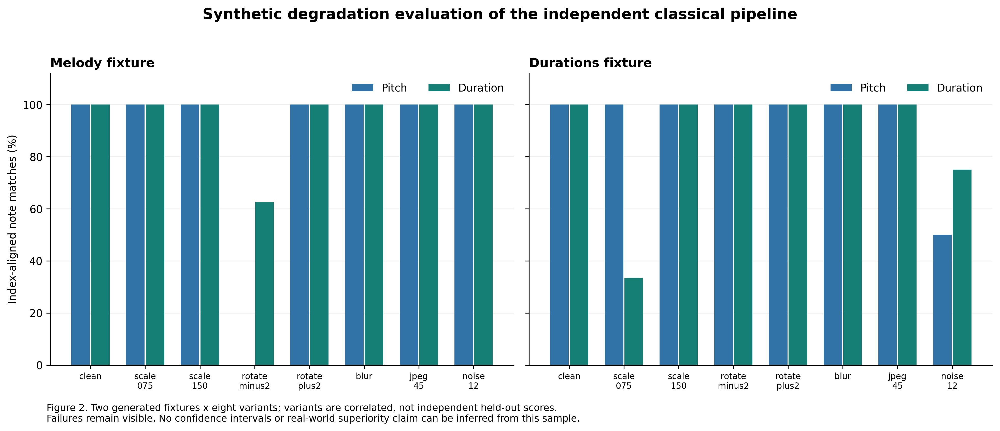

# Xunpu GraphOMR

**Explainable optical music recognition with typed symbol graphs and music-aware reconstruction.**

Xunpu GraphOMR is a research prototype by **Xudong Dai** for reconstructing musical structure from score images. Instead of treating OMR as symbol classification alone, the project makes symbol relationships explicit: detected notation objects become typed graph nodes, structural relations are inferred, and musical consistency checks are applied before export.

> **Repository status:** runnable classical baseline + experimental neural research modules. The repository does **not** claim a trained end-to-end CNN–HGT model or superiority over established OMR systems.

<p align="center">
  
</p>

## Research idea

```text
Score image / PDF
        ↓
Visual perception
        ↓
Typed music-symbol graph
        ↓
Relation reasoning
        ↓
Music-aware decoding
        ↓
OMR JSON / MusicXML / MIDI / diagnostics
```

The central question is whether **typed symbol relations + musical constraints** can make reconstruction more inspectable and robust than a purely local symbol-classification pipeline.

## What is implemented

| Layer | Public repository status |
| --- | --- |
| Image/PDF input, denoising, deskewing | Implemented |
| Staff geometry and scale estimation | Implemented |
| Filled/empty noteheads and stem attachment | Implemented |
| Treble-clef pitch reconstruction | Implemented in baseline scope |
| Whole/half/quarter duration reconstruction | Implemented in baseline scope |
| Typed symbol graph and geometric edge features | Implemented |
| Music consistency checks | Implemented for current 4/4 baseline |
| OMR JSON, MusicXML, MIDI, overlays | Implemented |
| Faster R-CNN symbol detector | Experimental scaffold; no released OMR weights |
| HGT relation model | Experimental scaffold; not the default decoder |
| General polyphonic / handwritten OMR | Not established |

The validated baseline currently assumes **printed, single-staff melody, treble clef, C major, and 4/4**. Beams, tuplets, arbitrary clefs/meters, handwriting, general polyphony, and multi-page assembly remain outside the validated scope.

## Example output

<p align="center">
  
</p>

The repository keeps intermediate graph and reconstruction data inspectable rather than emitting only a final score file.

## Reproducible baseline evidence

The included regression evaluation uses **2 procedural score fixtures × 8 deterministic image conditions** (clean, scaling, rotation, blur, JPEG compression, and noise).

<p align="center">
  
</p>

Current generated results:

- mean pitch match: **96.9%**;
- mean duration match: **94.3%**;
- exact pitch + duration sequences: **14/16** variants;
- lightweight XML parse check: **16/16** outputs.

These are correlated synthetic regression cases, **not an independent real-score benchmark**. Failures are intentionally retained. See [`examples/output/EVALUATION.md`](examples/output/EVALUATION.md) and [`examples/output/results.json`](examples/output/results.json).

## Quick start

Requires Python 3.11+.

```bash
python -m venv .venv
source .venv/bin/activate          # Windows: .venv\\Scripts\\activate
python -m pip install -e '.[dev]'

xunpu-graph-omr recognize examples/input/simple_score.png \
  -o out/score.musicxml \
  --omr-json out/score.omr.json \
  --report out/score.report.json \
  --midi out/score.mid \
  --debug-dir out/debug
```

Generate the full stress evaluation locally:

```bash
xunpu-graph-omr portfolio --output out/evaluation
python -m pytest -q
```

Optional neural modules:

```bash
python -m pip install -e '.[gnn,detect]'
python -m pytest -q tests/test_neural_models.py
```

## Repository structure

```text
Xunpu-GraphOMR/
├── src/xunpu_graph_omr/
│   ├── vision/          # image processing + symbol perception
│   ├── graph/           # typed graph + HGT research modules
│   ├── decoding/        # measure/rhythm/structured reconstruction
│   ├── export/          # MusicXML / MIDI / Jianpu helpers
│   ├── evaluation/      # synthetic fixtures + metrics
│   ├── pipeline.py      # runnable baseline orchestration
│   └── cli.py
├── docs/
│   ├── ARCHITECTURE.md
│   ├── ALGORITHM.md
│   └── PATENT.md
├── examples/
│   ├── input/
│   └── output/
└── tests/
```

This layout intentionally separates **visual perception**, **graph reasoning**, **decoding**, and **interoperable export** so reviewers can inspect the research boundaries quickly.

## Research architecture

The experimental learned route is:

```text
CNN detector
  → heterogeneous symbol graph
  → HGT relation prediction
  → music-aware constrained decoding
  → structured score
```

The shipped default route remains an independent OpenCV/geometric baseline. This distinction is deliberate: proposed research components are not presented as already trained or validated capabilities. See [`docs/ALGORITHM.md`](docs/ALGORITHM.md) and [`docs/ARCHITECTURE.md`](docs/ARCHITECTURE.md).

## Related patent application

A related Chinese invention patent application was published on **2026-05-15**:

- **Application:** `202610254567.4`
- **Title:** `一种基于异质图神经网络的符号化复音数据异常检测与纠错方法及相关设备`

The application concerns heterogeneous-graph-based anomaly detection and correction for symbolic polyphonic data. Xunpu GraphOMR is a broader OMR research prototype; this repository does **not** claim that every component falls within the application's claims. See [`docs/PATENT.md`](docs/PATENT.md).

The original CNIPA notice is not mirrored here because it contains unnecessary personal contact/address information.

## Disclosure boundary

Public in this repository:

- system architecture and mathematical formulation;
- runnable classical baseline;
- selected experimental CNN/HGT scaffolding;
- deterministic evaluation fixtures and retained failures;
- interoperable output examples.

Not included:

- private datasets or credentials;
- unreleased trained model weights;
- production deployment secrets;
- unpublished future invention details that are not needed to reproduce the public baseline.

## License and citation

This repository is a **source-available research preview**, not an open-source release. Local academic evaluation is permitted under [`LICENSE`](LICENSE); no patent license is granted. Third-party dependencies remain under their own licenses; see [`docs/THIRD_PARTY.md`](docs/THIRD_PARTY.md).

Citation metadata is provided in [`CITATION.cff`](CITATION.cff).
